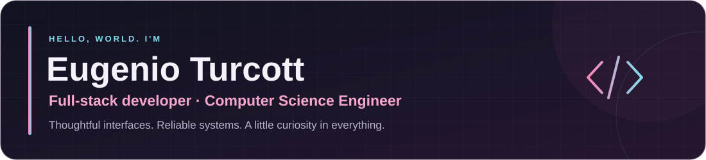
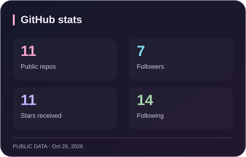
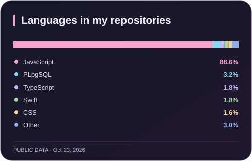

  

  Building things that bring people together. Currently, that means music. 🎧 
  Based in Monterrey, Mexico · Curious about the entire journey from idea to production.

  
  

  
  

## What I'm building

### 🎵 Musiclub · Music, community & discovery

A music community where people discover releases, share track-by-track reviews, rate cover art and listen together.

I build and maintain the product across the stack: the interface, APIs, PostgreSQL data model, authentication, background integrations and deployment.

- **Discover:** artist discographies, genre identities and a searchable release catalogue.
- **Share:** community reviews, personal profiles and cover-art ratings.
- **Listen together:** seasonal release pools and an arcade-style discovery experience.
- **Keep it dependable:** automated checks, access controls and continuous improvements.

**Next.js · React · JavaScript · Tailwind CSS · Supabase · PostgreSQL · Vercel · GitHub Actions**

[Explore Musiclub ↗](https://www.musiclub.org) · [View the source ↗](https://github.com/eugenio-turcott/musiclub-albumes)

## My toolkit

**Web & interfaces**

  

**APIs, data & delivery**

  

**Also explored**

  

## A few things from the journey

| Project | Focus | Links |
| :--- | :--- | :--- |
| **Musiclub** | Full-stack music community · current project | [Live site](https://www.musiclub.org) · [Repository](https://github.com/eugenio-turcott/musiclub-albumes) |
| **IronWall** | React frontend and Python backend repositories | [Frontend](https://github.com/eugenio-turcott/Frontend_IronWall) · [Backend](https://github.com/eugenio-turcott/Backend_IronWall) |
| **PLANETIFY** | Previous project · React frontend and FastAPI backend | [Repository](https://github.com/eugenio-turcott/PLANETIFY) |
| **RayosX** | Swift project built with a team | [Repository](https://github.com/eugenio-turcott/RayosX_Recolector) |

## GitHub, at a glance

  
  

  Real public GitHub data, refreshed daily. Language percentages describe repository bytes, not proficiency. 
  These cards live in this repository, so they stay visible even when a third-party widget is unavailable.

## Find me elsewhere

  
  
  

Made with curiosity, care, and probably a cat somewhere nearby. 🐈

